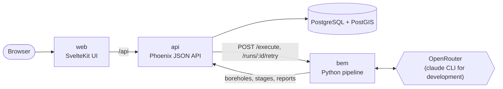
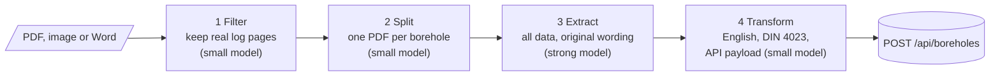

# smart-automation

Automated extraction and standardisation of drilling data for a global geodatabase — a hackathon project for the Herrenknecht AG challenge ([Hackathon Portal](https://hackathon.badencampus.de/en/challenges/66f8c41f-b62a-4a84-a356-79546bc9c68b)).

> **Research project, not production software.** This was built during a hackathon. There is **no authentication or authorisation whatsoever**: everyone who can reach the API can read, create and delete data, including the source documents. Do not expose it to the internet, do not run it in production and do not load confidential documents into an instance you do not control. Uploaded pages are processed with an external LLM (OpenRouter, Claude) depending on the configuration.

## What it does

Legacy borehole logs (scanned or digital PDFs, multilingual, many layouts) are turned into structured, searchable data:

1. **Upload** a borehole report in the web app and choose the model and effort per pipeline step.
2. **Extract**: the pipeline finds the real borehole log pages, splits the report into one PDF per borehole, extracts depth intervals, lithology, stratigraphy and metadata (location, date, elevation) in the original wording, and translates and normalises it to English and to the DIN 4023 terms.
3. **Georeference**: coordinates in local systems (e.g. Gauss-Krüger) are reprojected to WGS84 in PostGIS.
4. **Store** boreholes, layers and the source document in a central PostGIS database.
5. **Search and explore** on an interactive world map, with a query language (name, place, date) and autocompletion, and view each borehole as a DIN 4023 profile column next to its source document.

Every pipeline run is tracked per stage (status, model, tokens, cost) and visible in the web app. A whole run or a single failed extract/transform job can be retried. Boreholes generated for demos are marked `metadata.source = "mock"`.

## Production setup

Everything runs with Docker Compose (`db`, `api`, `web`, `pipeline`). Keep in mind the warning above: put it behind a trusted network or a reverse proxy with authentication.

```bash
cp .env.example .env
# edit .env: set POSTGRES_PASSWORD and SECRET_KEY_BASE (openssl rand -base64 48),
# and add OPENROUTER_API_KEY for the pipeline
docker compose up --build
# open http://localhost:3001
```

- **AI backend:** OpenRouter is the default (`BEM_AI=openrouter`, uses `OPENROUTER_API_KEY`, optionally `BEM_OPENROUTER_MODEL` to force one model). The `claude` CLI backend (`BEM_AI=claude_cli`, with `ANTHROPIC_API_KEY` or `CLAUDE_CODE_OAUTH_TOKEN`) is meant for development only.
- **Without LLM credentials** the stack still starts; uploads are stored, but extraction runs fail. To see the map and search with data, set `SEED_MOCK_DATA=true` (loads 10 example boreholes plus `MOCK_BOREHOLES` generated ones).
- **Ports** (`.env`): web `WEB_PORT` (3001), API `API_PORT` (4001), pipeline `BEM_PORT` (8000), Postgres 5432. Only the web port needs to be reachable by users; remove the other `ports:` entries from `docker-compose.yml` if you do not need them.
- **Data** lives in the Docker volumes `db_data` (database) and `document_storage` (source documents). `docker compose down -v` deletes both.
- The pipeline queue is in memory: restarting the `pipeline` container loses queued runs.

## Development setup

Prerequisites: Docker, Elixir/Erlang, Node.js ≥ 22.13 with pnpm, and for the pipeline [uv](https://docs.astral.sh/uv/), poppler and an OpenRouter API key (the Claude Code CLI works as a development-only alternative).

```bash
docker compose up -d db      # PostGIS on localhost:5432
cd api && mix setup && mix phx.server   # API on :4000, seeds example + mock boreholes
cd web && pnpm install && pnpm dev      # UI on :5173, proxies /api to :4000
cd bem && uv sync && uv run python -m pipeline.server   # optional, pipeline on :8000
```

Each part has its own setup details: [api](api/README.md#development-setup), [bem](bem/README.md#development-setup), [web](web/README.md#development-setup).

## Documentation

Read the readme of each component: [api](api/README.md), [bem](bem/README.md), [web](web/README.md) for detailed setup and usage instructions.

See [docs/](docs/) for detailed documentation on architecture, API reference, and design decisions.

### Architecture



| Part           | Role                                                                                           | Docs                           |
| -------------- | ---------------------------------------------------------------------------------------------- | ------------------------------ |
| [`api/`](api/) | Owns the data model, georeferencing, search and document storage; exposes the REST API         | [api/README.md](api/README.md) |
| [`bem/`](bem/) | Four-stage LLM pipeline (filter → split → extract → transform) that turns a PDF into boreholes | [bem/README.md](bem/README.md) |
| [`web/`](web/) | Map, search, borehole profile, upload and pipeline monitoring                                  | [web/README.md](web/README.md) |

More detail: [docs/architecture.md](docs/architecture.md) (flows), [docs/api-reference.md](docs/api-reference.md) (endpoints), [docs/adr/](docs/adr/) (decisions).

### Pipeline architecture

The pipeline in [`bem/`](bem/) is a chain of four small stages instead of one big prompt, so each stage is cheap to retry, measurable and can use the model that fits its job:



- **Triggered by the API:** a run is started with `POST /execute` (document id, model and effort per stage). The pipeline downloads the document from the API, converts images and Word to PDF, and works through the stages in the background.
- **Parallel and per borehole:** pages are classified in chunks, and extract and transform run once per borehole, in parallel.
- **Tracked:** every stage is an `exec_stage` in the API with status, model, effort, result, error, tokens and cost, so the web app shows live progress for every run and borehole.
- **Fail-safe:** a borehole is only stored when it passes the DIN 4023 check and its upload succeeds. A failed or stopped extract or transform job can be retried on its own without redoing the rest ([ADR-0044](docs/adr/0044-retry-single-pipeline-jobs.md)), and a run can be stopped at any time.
- **Pluggable AI backend:** OpenRouter by default, with the `claude` CLI for development (`BEM_AI`), so models can be swapped without touching the stages.
- **Decoupled:** the pipeline talks to the API only over HTTP, never to the database or the document storage.

### Standardisation: one vocabulary for all parts

Every borehole is brought into the same standard, based on the German norm **DIN 4023** (drawing of soil and rock in borehole logs): soil and rock names, short forms, hatch patterns and colours. The norm is kept as a single data file, [`standards/din-4023/din-4023.json`](standards/din-4023/din-4023.json), which is the source of truth for the whole system ([ADR-0022](docs/adr/0022-shared-din-4023-standard-file.md)):

- **`bem`** normalises the extracted petrography to the norm's terms (`"sand,schluffig"` → `"Sand, schluffig"`, keeping the original wording in the metadata). A borehole with a layer that cannot be mapped is not uploaded; nothing is guessed.
- **`api`** stores the standardised values (English, metric, WGS84), so every borehole has the same shape whatever its source looked like.
- **`web`** draws the profile column from the same file: hatch patterns, colours and short forms follow the norm.

Because all three parts read the same file, a log from any company, language or decade ends up comparable and searchable in one database.

## Scope and room to grow

The hard part of this challenge is not the web app, it is turning messy, multilingual, scanned borehole logs into trustworthy standardised data. That is where the hackathon time went: the four-stage pipeline (filter → split → extract → transform) with DIN 4023 conformance, per-stage tracking and retries, the PostGIS data model with georeferencing, and the API that ties them together. The web app is deliberately a thin layer on top of that architecture, and a lot of product work is left on purpose, because the architecture makes it cheap to add:

- **Users and access:** authentication, roles, per-project data separation and audit logs (today there is none, see the warning above).
- **Document management:** uploading additional documents to a borehole, new versions, renaming, deleting, sharing links.
- **Human review:** editing extracted values, approving results and feeding corrections back as evaluation data.
- **Quality measurement:** a ground-truth set and per-field accuracy and confidence scores for the extraction.
- **Scale and operations:** a persistent job queue instead of the in-memory one, self-hosted models for confidential data, monitoring.
- **Richer geology:** stratigraphic lookup tables, groundwater and sample symbols in the profile, cross sections between neighbouring boreholes, export to standard formats.

## Licence

Proprietary, all rights reserved (see [LICENSE](LICENSE) and [ADR-0041](docs/adr/0041-proprietary-all-rights-reserved-licence.md)). The data in `data/` and all dependencies are owned by third parties and are not covered.
