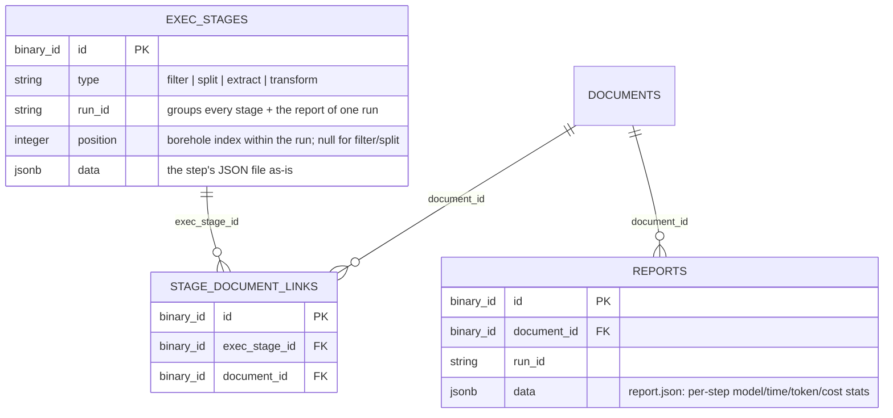

# ADR-0034 – `exec_stages`/`reports` replace bem's pipeline tracking (direct Claude pipeline)

## Context

`bem/` (OCR → dictionary/local-LLM translation → triage → extraction, ADR-0001) is dropped. Its
replacement is `claude_test/` (`claude_test/README.md`): a pipeline of `claude -p` calls that
turns one borehole PDF into one or more `POST /api/boreholes` payloads in four steps —
`01_filter` (keep only borehole-log pages), `02_split` (one PDF per borehole), `03_extract`
(raw-language JSON per borehole), `04_transform` (English, DB-shaped `{payload,
validation_issues}` per borehole). Every run writes these under `out/<pdf-name>/`, every file
prefixed with a shared run id (`YYYYMMDD-HHMMSS`), plus a `report.json` (per-step model/time/
token/cost stats) and a `result.json` (all boreholes' payloads combined) — see
`api/priv/out/AF01/` for a real example copied in during this design.

The tables ADR-0030 built (`pipeline_stage_runs`, `triage_sections`, `extraction_results`,
`sink_results`) are shaped around bem's five named stages (OCR, translation, triage, extraction,
sink) and its one-row-per-document-or-section, latest-run-only model. They don't fit a pipeline
that (a) has different, fewer stages, (b) keeps every run instead of only the latest, and (c)
needs a stage's output (e.g. one `03_extract` result) traceable both to the original source
document and, once split, to the per-borehole PDF it was produced from.

## Decision

Replace the four bem-specific tables with three generic ones:

- **`exec_stages`**: one row per step execution. `type` (`filter | split | extract | transform`),
  `run_id` (the shared run-id string, groups every stage and the report of one pipeline run),
  `position` (which borehole within the run — 1, 2, … — for `extract`/`transform`; `null` for the
  whole-document `filter`/`split` steps), `data` (jsonb — the step's JSON file as-is:
  `classification.json`, `grouping.json`, the raw extraction, or `{payload, validation_issues}`).
  Append-only (unlike ADR-0030's latest-run-only tables): reruns add new rows, so the history of a
  document's extraction attempts is kept for comparison/debugging.
- **`stage_document_links`**: many-to-many join between `exec_stages` and `documents`. A `filter`
  stage links only to the original source document; an `extract`/`transform` stage for one
  borehole can link to *both* the original source document and the split-out per-borehole PDF
  (once that is itself tracked as a `documents` row) — hence many-to-many rather than a single
  `document_id` foreign key on `exec_stages`.
- **`reports`**: one row per pipeline run, `document_id`, `run_id`, `data` (jsonb — `report.json`
  as-is: step name, model, effort, tokens, cost, wall/API seconds). Kept separate from
  `exec_stages` because it describes the whole run, not one step, and has no `position`.
- Drop `pipeline_stage_runs`, `triage_sections`, `extraction_results`, `sink_results` and the
  `PipelineController` endpoints built for them (ADR-0030) — bem is gone, nothing writes to them
  anymore.
- `POST /api/boreholes` (ADR-0031) is unchanged: `04_transform`'s `payload` is already shaped as
  `{borehole, layers}`, so `result.json` can be posted as-is per borehole.

## Pros

- Three generic tables instead of four bem-shaped ones; `type`/`data` adapts to a pipeline with a
  different number/kind of stages without a schema change.
- Append-only history makes "did this prompt change actually help" answerable directly from the
  table instead of only from `out/` on someone's laptop.
- The many-to-many link lets a stage's output be found from either the original upload or the
  split-out borehole PDF, once the latter is tracked too.

## Cons

- `data`/jsonb is free-form, same trade-off ADR-0030 already accepted for `output`/
  `extracted_fields`.
- Append-only means no upsert-based idempotency: re-running a document's pipeline adds rows
  rather than replacing them; nothing here prunes old runs.
- No ingestion endpoint is decided here — something still has to `PUT`/`POST` `out/`'s files into
  these tables. Left for a follow-up ADR once that pipeline is wired to the API (see ADR-0033 for
  the upload endpoint it would plug into).

## Alternatives

- Keep ADR-0030's tables and just repurpose `stage`'s allowed values: rejected, the
  latest-run-only/1:1-document model doesn't fit an append-only, per-borehole-linked pipeline.
- A single `document_id` foreign key on `exec_stages` instead of a join table: simpler, but can't
  express a stage belonging to both the source document and its split-out borehole PDF.

## Consequences

- `docs/data-model.md`'s "Pipeline stage tracking" section is replaced by this ADR's diagram.
- `bem/API_INTEGRATION.md` and the bem-specific parts of ADR-0032/ADR-0033 (the `bem-serve`
  worker) describe a pipeline that no longer runs; they stay as a record of what was built, not
  removed, per the project's ADR convention of adding new decisions instead of rewriting old ones.

## References

- ADR-0001, ADR-0013, ADR-0014, ADR-0030, ADR-0031, ADR-0032, ADR-0033
- `claude_test/README.md`
