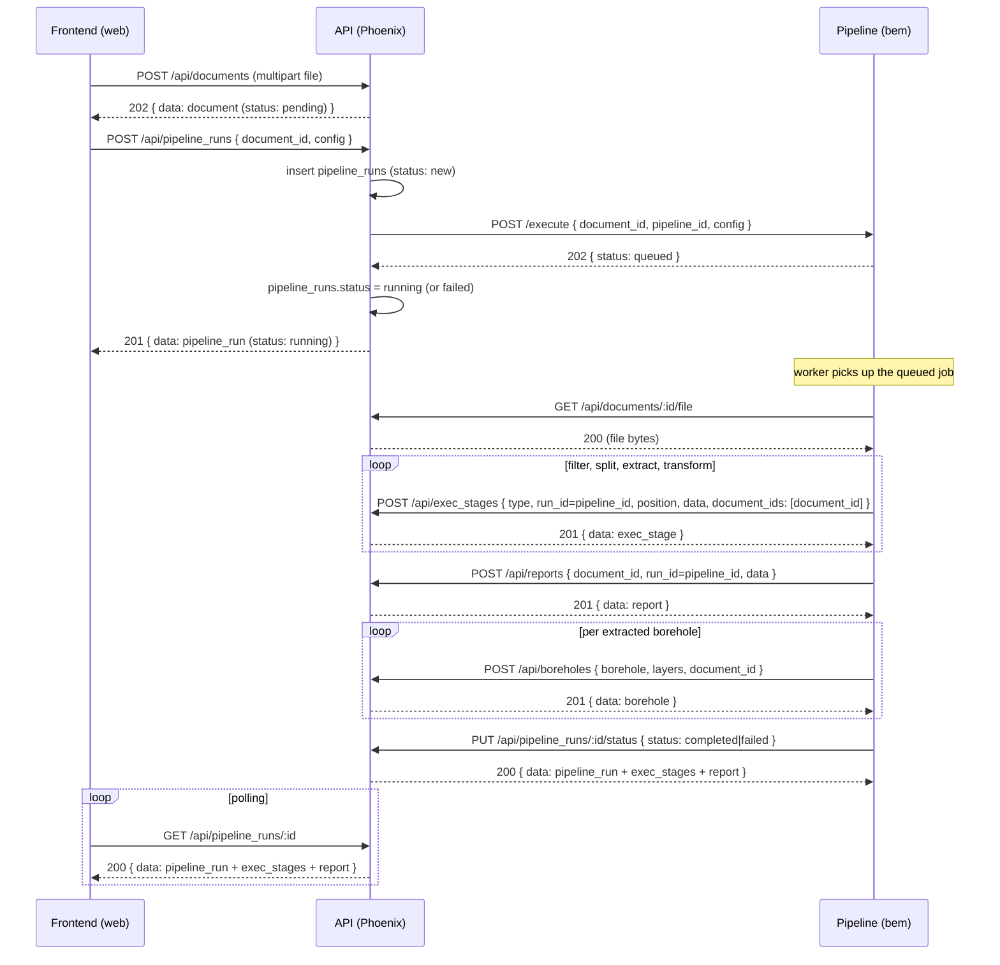

# ADR-0037 – End-to-end document → pipeline run → boreholes flow (consolidated)

## Context

The document-upload → pipeline-run → stage-tracking → borehole flow was built incrementally
across ADR-0033 (upload), ADR-0034 (`exec_stages`/`stage_document_links`/`reports`) and ADR-0035
(`pipeline_runs`) — and ADR-0035 itself was then amended twice in the same working session: once
to make the submission webhook file-free (`pipeline_id` instead of pushing the file), once because
the real pipeline (`bem/`) reports a run's completion via `PUT /api/pipeline_runs/:id/status`, not
a document status. Reading ADR-0035 top to bottom, plus its amendment note, no longer gives one
coherent picture of what actually happens today.

Per this project's ADR convention (`CLAUDE.md`'s "ADRs" section), we don't keep rewriting an old
ADR's history to fold in amendments — we add a new ADR that documents the current end state in one
read and references the ones it consolidates, rather than superseding them.

This ADR was written by re-deriving the contract directly from the current code — `router.ex`, the
`DocumentController`/`PipelineRunController`/`ExecStageController`/`ReportController`,
`Api.Boreholes`, `Api.Pipeline`, and `bem/`'s own account of what it calls, in `bem/README.md`,
`bem/pipeline/api_service.py` and `bem/pipeline/server.py` — not from prior ADR prose, which may
already be stale.

## Decision

Document the full current flow as one coherent sequence:

1. **Upload**: the frontend `POST`s a raw file to `POST /api/documents` (multipart field `file`,
   ADR-0033). The API stores it in the managed storage (ADR-0014) and inserts a `documents` row
   with `status: "pending"`. This no longer triggers any processing by itself (ADR-0035) — it only
   stores the file.
2. **Submit a run**: once the frontend has a per-stage model/effort `config` to send, it calls
   `POST /api/pipeline_runs` with `{document_id, config}`. `Api.Boreholes.create_pipeline_run/1`
   inserts a `pipeline_runs` row (`status: "new"`), then `Api.Pipeline.submit_pipeline_run/1`
   synchronously posts a small, file-free JSON body — `document_id`, `pipeline_id` (the
   `pipeline_runs` row's own `id`) and `config` — to `PIPELINE_URL` (`bem/`'s `POST /execute`). On
   success the run moves to `"running"`; if the pipeline refuses the request or can't be reached it
   moves to `"failed"`; if no `PIPELINE_URL` is configured it stays `"new"` (processing not wired
   up). The `POST /api/pipeline_runs` response reflects whichever of these happened.
3. **Pipeline fetches the file**: `bem/`'s worker (`server.py`'s `_worker`/`process`) downloads the
   document via `GET /api/documents/:id/file`, keyed by `document_id` — the same endpoint used for
   in-app document viewing (ADR-0026). The webhook in step 2 never carries file bytes.
4. **Pipeline runs its four `claude -p` stages** (`filter` → `split` → `extract` → `transform`,
   `bem/README.md`; ADR-0034/ADR-0035 call this pipeline `claude_test/`, a name that no longer
   matches the repo) and, after each stage, posts its output to `POST /api/exec_stages`
   (`type`, `run_id` set to the `pipeline_id` it was given, `position` for `extract`/`transform`,
   `data`, `document_ids: [document_id]` — ADR-0034). This is append-only: rerunning a document adds
   new rows rather than replacing previous ones.
5. **Report**: once all four stages finish, the pipeline posts the run's stats to
   `POST /api/reports` (`document_id`, `run_id` = `pipeline_id`, `data` = `report.json` as-is,
   ADR-0034).
6. **Boreholes**: for each extracted borehole, the pipeline (`bem/README.md`) posts
   `POST /api/boreholes {borehole, layers, document_id}` (ADR-0031), attaching the new borehole to
   the original uploaded document as its `"original"` (ADR-0028). A borehole whose petrography
   can't be mapped to DIN 4023 is not uploaded and the run is marked failed.
7. **Completion callback**: the pipeline calls `PUT /api/pipeline_runs/:id/status` with
   `{"status": "completed"}` or `{"status": "failed"}`. `pipeline_runs.status` — not any
   `documents.status` — is the source of truth for a run's outcome; nothing currently updates
   `documents.status` when a run finishes (the two can disagree, flagged as an open question since
   ADR-0035).
8. **Polling**: the frontend polls `GET /api/pipeline_runs/:id` at any point to show live progress
   — the run plus its `exec_stages` (newest first) and `report` (`nil` until posted).

`PUT /api/documents/:id/status` still exists (ADR-0033) but the pipeline described above never
calls it — it is legacy/manual-only bookkeeping now, not part of this flow.

## Pros

- One read gives the current, complete contract instead of ADR-0035 plus its amendment note plus
  cross-checking ADR-0033/ADR-0034.
- Re-deriving from code instead of copying prior ADR prose surfaced a couple of inaccuracies, now
  also fixed in `docs/api-reference.md` and `docs/elixir-backend-borehole-pipeline.md` (see their
  own history for specifics) rather than silently kept.

## Cons

- A fourth document (on top of ADR-0033/0034/0035) describing closely related ground; a reader
  still benefits from skimming the superseded ones for the *why* behind each piece, this ADR only
  gives the *what*/current state.

## Alternatives

- Amend ADR-0035 a third time: rejected, per `CLAUDE.md`'s ADR convention — amendments already made
  it hard to read in one pass, a fourth would make it worse, not better.
- Fold this into `docs/api-reference.md` only, no ADR: rejected — the architectural *decision*
  (file-free webhook, `pipeline_id` vs `run_id`, completion via `pipeline_runs` status) belongs in
  an ADR; `docs/api-reference.md` stays the request/response reference.

## Consequences

- `docs/api-reference.md` and `docs/elixir-backend-borehole-pipeline.md` cross-reference this ADR
  near the top as the current end-to-end account, alongside the still-valid ADR-0033/0034/0035.
- Future amendments to this flow should still prefer a new ADR over rewriting this one once it
  accumulates its own amendment history — same convention this ADR itself follows.

## References

- ADR-0014, ADR-0031, ADR-0033, ADR-0034, ADR-0035
- `docs/api-reference.md`, `docs/elixir-backend-borehole-pipeline.md`
- `bem/README.md`, `bem/pipeline/api_service.py`, `bem/pipeline/server.py`
