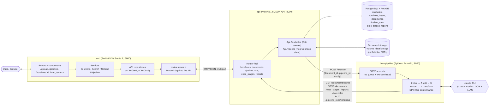
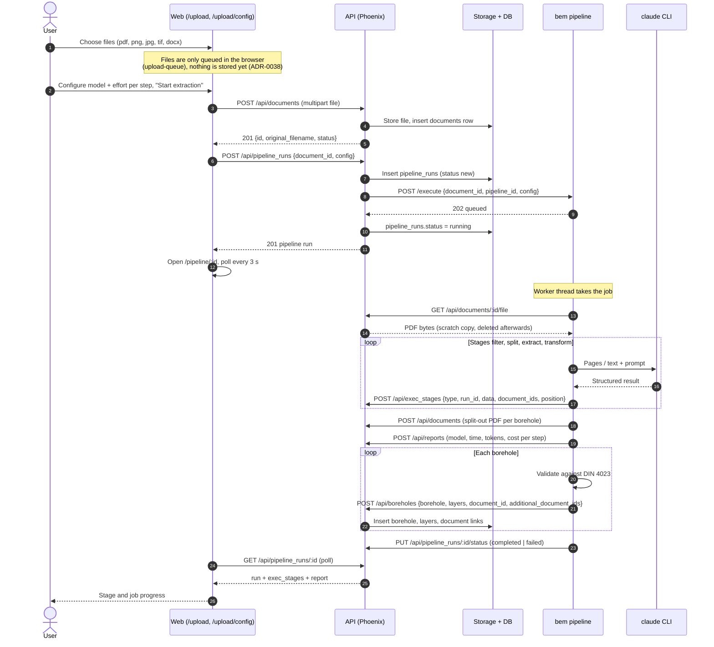
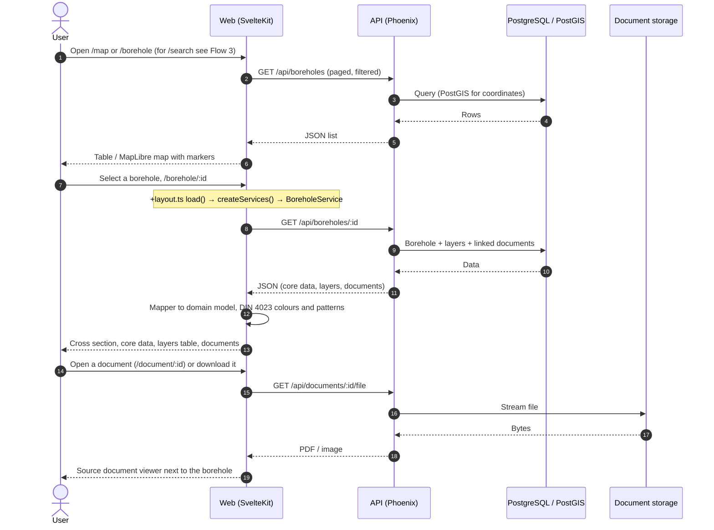
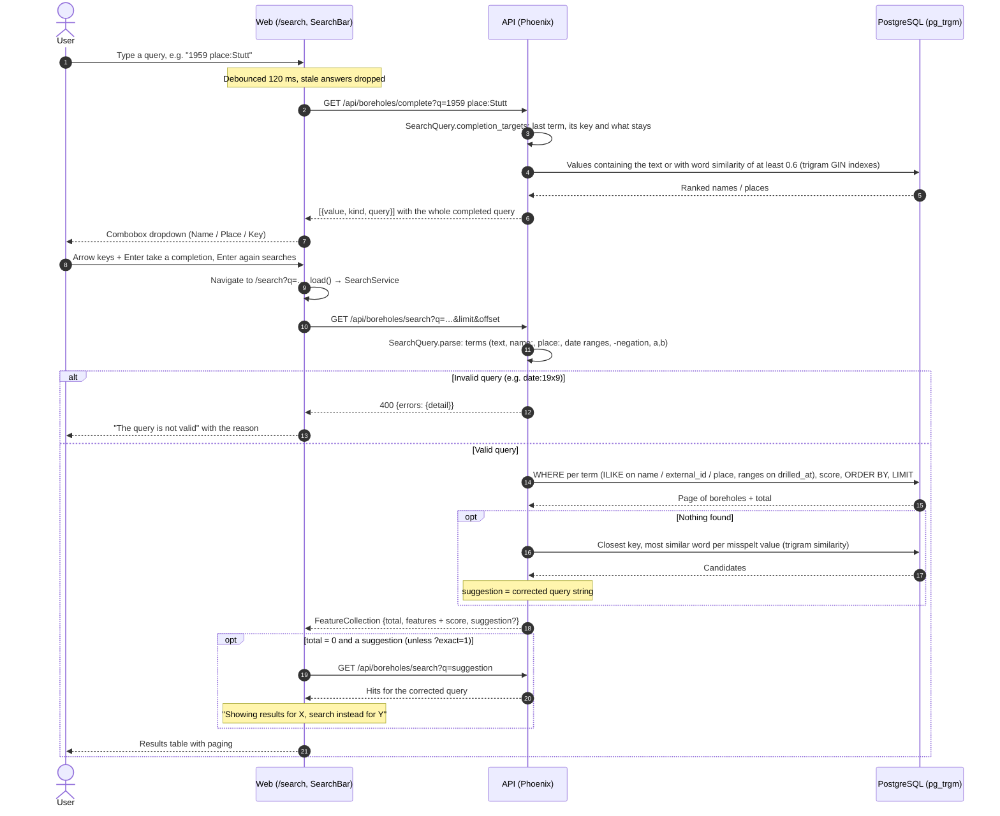

# Architecture

Snapshot of the current system (code state of 2026-10-17). Decisions behind it are in [`adr/`](adr/), the endpoints in [`api-reference.md`](api-reference.md).

## Components

All four services run via `docker-compose.yml` (`db`, `api`, `web`, `pipeline`). The web app talks only to the API (ADR-0029); the pipeline never touches the database or storage directly, it only uses the API.

## Flow 1: Upload a document and start a parsing pipeline

Notes:

- The webhook call carries no file bytes; the pipeline pulls the file by `document_id` (ADR-0033).
- Without `PIPELINE_URL` the run stays `new` and nothing is processed. If the pipeline cannot be reached the run is `failed`.
- Only the stage results of a run whose `run_id` equals the `pipeline_runs.id` show up in the UI (ADR-0039).

## Flow 2: View a borehole in the UI

Notes:

- UI → service → repository → API (ADR-0009). UI code does not import repositories (ESLint enforces it).
- In `pnpm dev` the Vite proxy forwards `/api`; in Docker `hooks.server.ts` forwards it to `API_INTERNAL_URL`.
- Editing and review pages (`/borehole/:id/edit`, `/review`) exist, but saving changes is not wired to the API yet.

## Flow 3: Search boreholes

The search page has one input for a small query language over borehole name, place and drilling date (ADR-0042), with completions while typing (ADR-0043). The API parses the query and runs it in PostgreSQL; the web only passes the string through.

Notes:

- **Query language** (all terms must match, case-insensitive): bare words and `"phrases"` match name, external id or place; `name:` / `n:`, `place:` / `location:` / `loc:` restrict the column; `date:` takes a year, month, day (`1959-06-12` or `12.06.1959`), a range (`1950..1960`, `1990..`, `..1960`) or a comparison (`>`, `>=`, `<`, `<=`), with `after:` / `before:` as short forms; a bare year or range is a date. `a,b` means either value, `-term` negates. Full syntax in [`api-reference.md`](api-reference.md#search-query-language) and in the Help drawer of the search page.
- **Where the code is:** parser and completion targets in `Api.Boreholes.SearchQuery`; SQL building, scoring, `suggest_query/1` and `complete_query/2` in `Api.Boreholes`; endpoints `search` and `complete` in `BoreholeController` (registered before `/boreholes/:id`). In the web: `SearchService` (autocorrect re-query, `InvalidSearchQueryError`), `ApiSearchRepository`, `SearchBar.svelte` (Skeleton Combobox), `SearchHelpDrawer.svelte`.
- **Indexes:** `pg_trgm` GIN indexes on `boreholes.name`, `external_id` and `place` serve substring matches (`ILIKE '%…%'`), completion candidates and autocorrection candidates; a B-tree on `drilled_at` serves date ranges.
- **Ranking:** per matched text value name 10, external id 8, place 5, plus 5 if the name starts with it; ties by name. Date terms filter only.
- **Autocorrection vs. completion:** completion uses word similarity of at least 0.6 while typing, so short inputs do not match unrelated values; autocorrection on search uses a looser similarity of 0.3 and only runs when nothing was found. The API returns the suggestion; the web runs it.
- **Not searched:** layer descriptions, purpose and client (ADR-0042).
