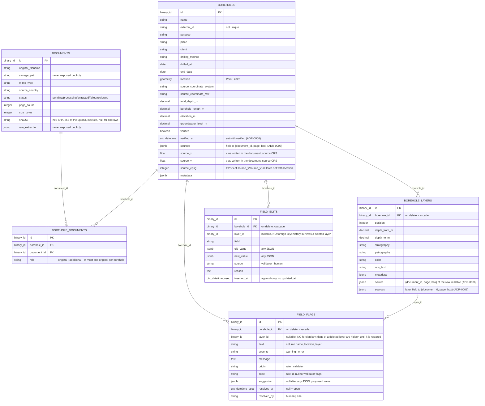
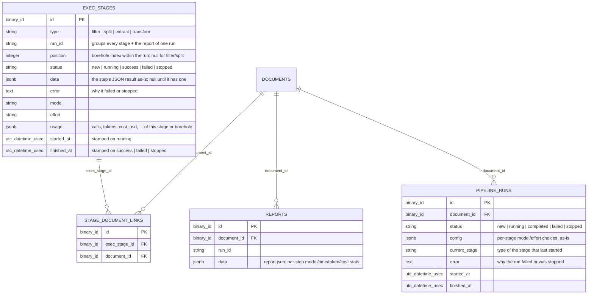

# Data Model

Entity-relationship diagram of the tables described in [elixir-backend-borehole-pipeline.md](elixir-backend-borehole-pipeline.md). Mermaid renders this directly in GitHub and VS Code's markdown preview, so it stays diffable as the schema evolves.

## Implemented

`field_flags` and `field_edits` (ADR-0006): flags are open until `resolved_at` is set (`field_flags.layer_id` has no foreign key like `field_edits.layer_id`: flags of a deleted layer stay in the table but are left out of `flags`, `open_flag_count`, sorting and filtering until the layer is restored with its old id); `exec_stages` timestamps have microsecond precision, so the newest row per `(type, position)` is unambiguous; edits are the append-only history of validator corrections and human edits. `old_value`/`new_value` are stored as `jsonb` through `Api.Boreholes.JsonValue` (a number, string, object or `NULL`). `location` values are `{"x", "y", "epsg"}`, `layer` values a snapshot of the layer. Layer `position` is always the rank by `depth_from_m`. The rules are in the [API reference](api-reference.md#plausibility-checks).

## Pipeline runs & stage tracking (implemented, ADR-0002)

See "Pipeline Runs & Stage Tracking" in [elixir-backend-borehole-pipeline.md](elixir-backend-borehole-pipeline.md) and [ADR-0002](adr/0002-document-intake-and-pipeline-runs.md) for the full flow. `exec_stages` keeps every attempt (reruns add rows, not upserts) and follows each stage through `new → running → success | failed | stopped` (ADR-0002); `pipeline_runs` tracks one submission/polling lifecycle per document and can be stopped.

