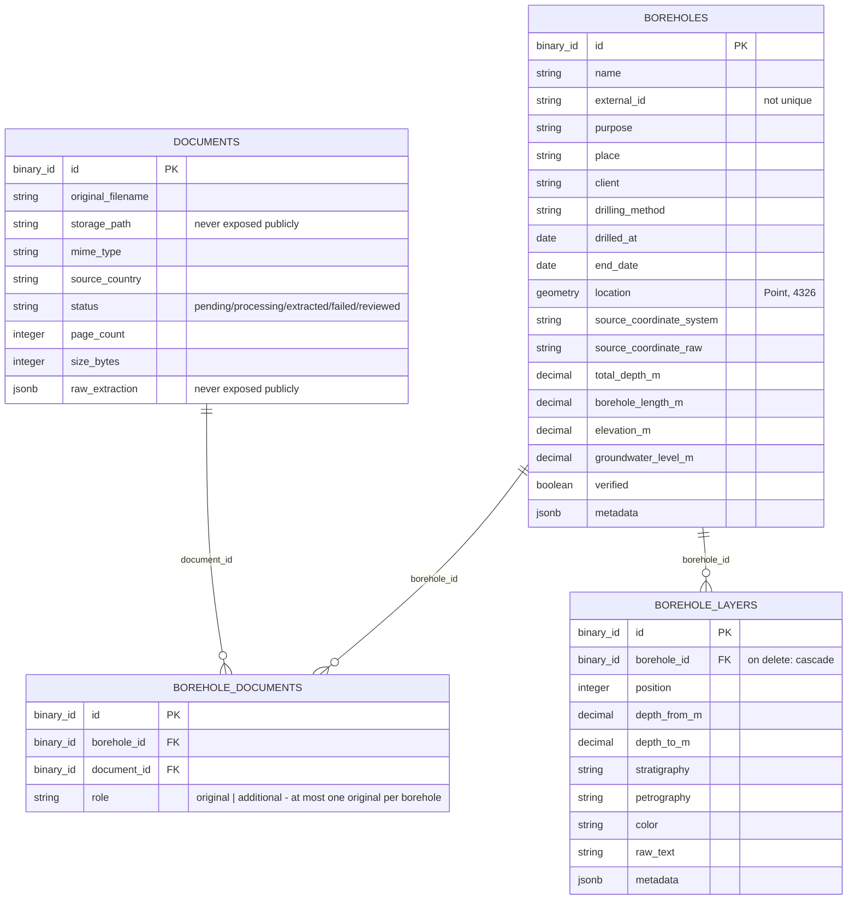
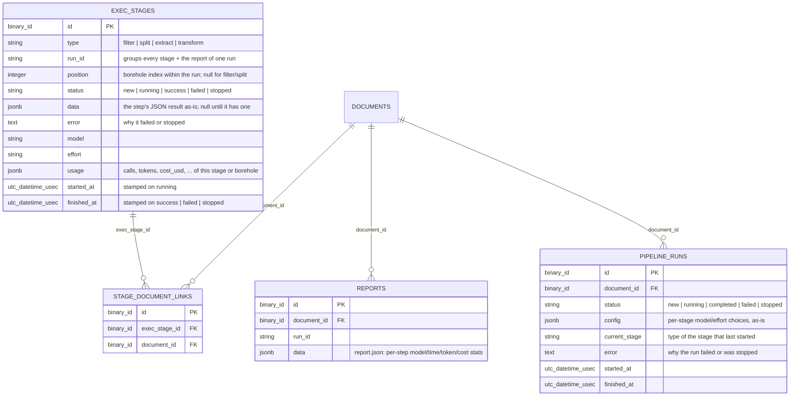

# Data Model

Entity-relationship diagram of the tables described in [elixir-backend-borehole-pipeline.md](elixir-backend-borehole-pipeline.md). Mermaid renders this directly in GitHub and VS Code's markdown preview, so it stays diffable as the schema evolves.

## Implemented

## Pipeline runs & stage tracking (implemented, ADR-0034/ADR-0035/ADR-0040)

See "Pipeline Runs & Stage Tracking" in [elixir-backend-borehole-pipeline.md](elixir-backend-borehole-pipeline.md) and [ADR-0037](adr/0037-end-to-end-document-pipeline-run-boreholes-flow.md) for the full flow. `exec_stages` keeps every attempt (reruns add rows, not upserts) and follows each stage through `new → running → success | failed | stopped` (ADR-0040); `pipeline_runs` tracks one submission/polling lifecycle per document and can be stopped.

