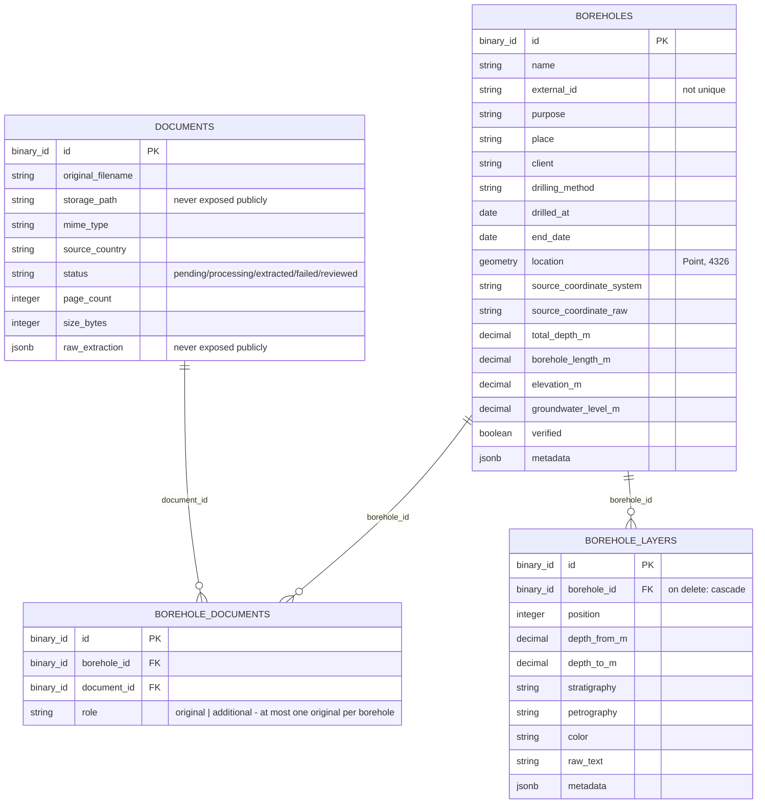
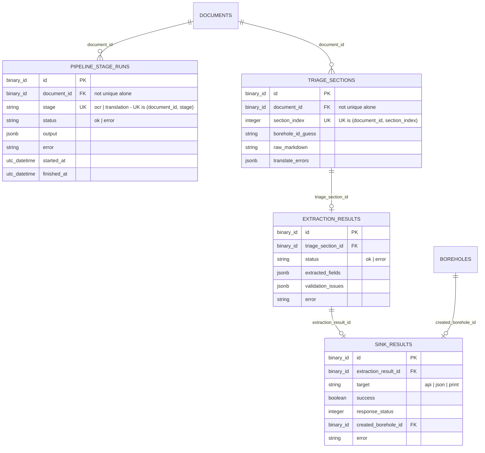

# Data Model

Entity-relationship diagram of the tables described in [elixir-backend-borehole-pipeline.md](elixir-backend-borehole-pipeline.md). Mermaid renders this directly in GitHub and VS Code's markdown preview, so it stays diffable as the schema evolves.

## Implemented

## Pipeline stage tracking (implemented, ADR-0030)

See "Pipeline Stage Tracking" in [elixir-backend-borehole-pipeline.md](elixir-backend-borehole-pipeline.md). Latest-run-only: a rerun upserts `pipeline_stage_runs`/`triage_sections` or cascades deletes down to `extraction_results`/`sink_results`.

